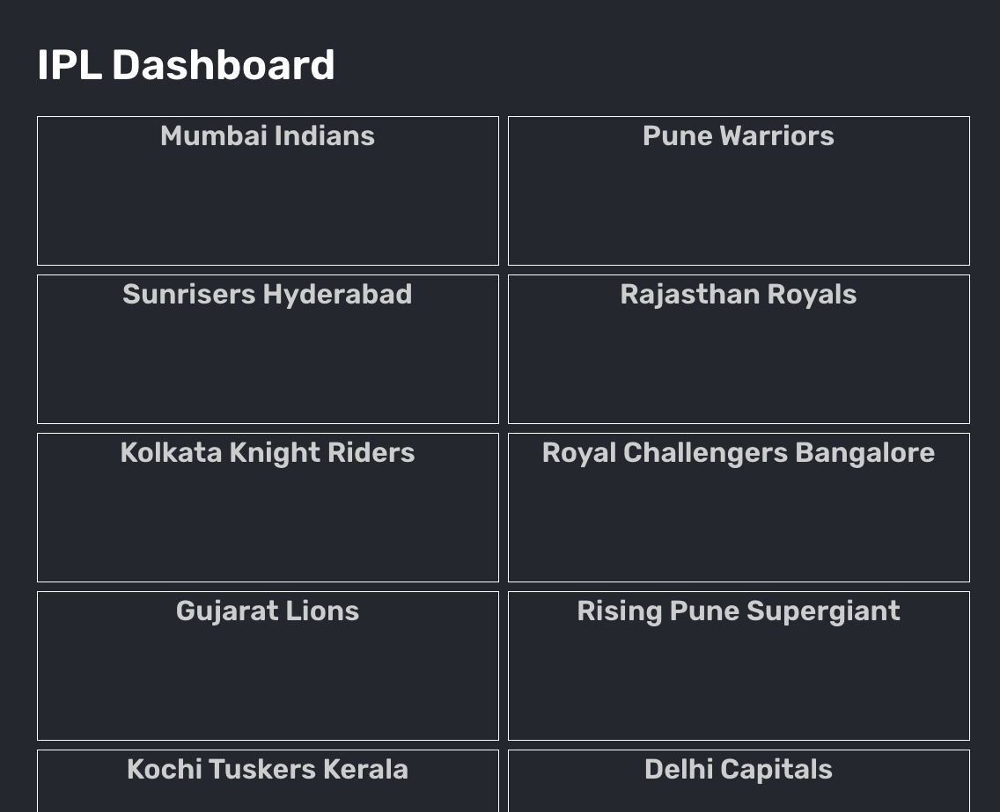
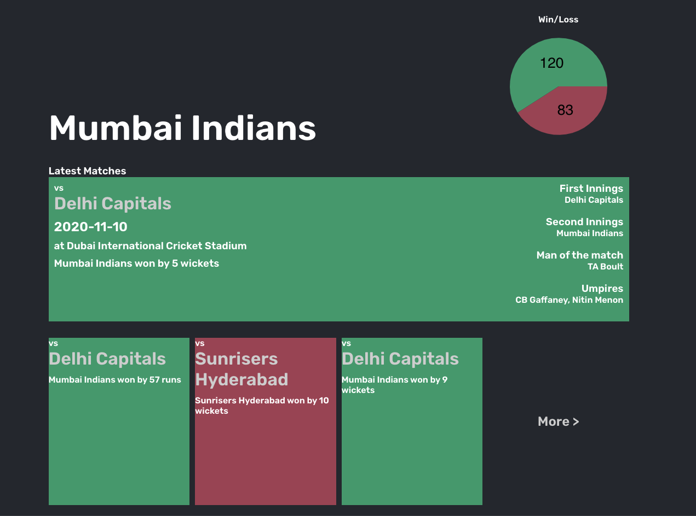
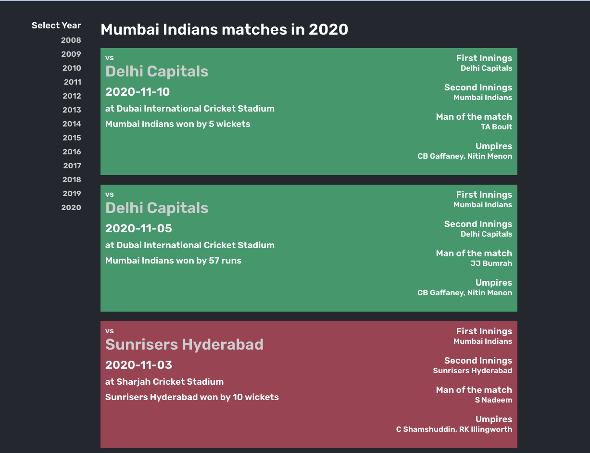

## Introduction
This is a full stack app built using spring boot and react. It's also using HSQL as an in-memory database to persist the data. During startup application ingest data to database from src/main/resources/match-data.csv using spring-batch.

### Requirements

- Java 21
- Node.js 24 and npm 11
- Maven 3.6.3 or later

### Running Docker Image
Use the following command to run this application as docker image.
```
docker run -d --name=ipl-dashboard -p 8080:8080 muditshukla3/ipl-dashboard:2-RELEASE
```

## Running Application in Kubernetes

### Using K8 Manifest
Use the following command to run the application kubernetes using k8 manifest.
```
kubectl apply -f deployment.yml
```
Run the following command to delete the deployment and service
```
kubectl delete deployment ipl-dashboard
kubectl delete services ipl-dashboard-nodeport
```
### Using Helm Chart
Make sure you have helm installed on your machine. Use the following command to deploy application using helm charts.

```
helm install web helm-charts/
```

Use the following command to uninstall
```
helm uninstall web
```

Access the application on http://localhost:31111. 31111 is the node port exposed vi k8 service component.


### Running frontend
```
cd src/frontend 
npm ci
npm start
```
The frontend calls the backend using relative URLs. During `npm start`, requests are proxied to http://localhost:8080 (see `proxy` in package.json), so start the backend first.

### Running spring boot app
```
mvn spring-boot:run
```

### Package
```
mvn clean verify
```
Above command will package the frontend and backend application in a single jar file. Running the jar file e.g. ```java -jar target/ipl-dashboard-0.0.2-RELEASE.jar ``` will run both and frontend and backend. Following maven plugin has been used to package frontend application as part of jar. The plugin does node and npm install and builds the frontend into src/frontend/build. The maven-resources-plugin then copies that build into target/classes/static, so it is packaged inside the jar and not added to the source tree. This makes frontend application available at http://localhost:8080/

```
<groupId>com.github.eirslett</groupId>
<artifactId>frontend-maven-plugin</artifactId>
```


## Application

### Dashboard Page



### Team Page



### Matches Page



# Spring Boot and Node.js Upgrade

Latest changes include updates to the application runtime and build toolchain.

## Versions

- Spring Boot `2.7.1` -> `4.1.1`
- Java `11` -> `21`
- Node.js `16.15.0` -> `24.22.0`
- npm `8.5.5` -> npm bundled with Node.js 24
- `frontend-maven-plugin` `1.6` -> `1.15.4`

## Application changes

- Migrated JPA and transaction imports from `javax.*` to `jakarta.*`.
- Replaced the removed Spring Batch builder factories with `JobBuilder` and
  `StepBuilder`.
- Injected `JobRepository` and `PlatformTransactionManager` into the batch step.
- Updated the executable JAR launcher for the current Spring Boot loader package.
- Replaced the obsolete `node-sass` dependency with Dart Sass.
- Switched Maven frontend installation from `npm install` to reproducible
  `npm ci`.
- Updated the Docker runtime image to Java 21.
- Documented the required Java, Node.js, npm, and Maven versions.